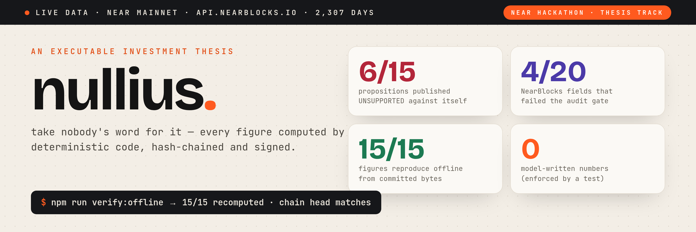

# nullius — take nobody's word for it

[](https://github.com/0xv3nm09/nullius/actions/workflows/ci.yml)


<p align="center">
  
</p>

**nullius is an audit layer for on-chain metrics, demonstrated on NEAR.** An **executable NEAR investment thesis**. Every figure is computed by deterministic code from raw on-chain captures, every figure carries a signed provenance receipt, and one command re-runs the whole thesis against NEAR mainnet and tells you which figures still reproduce.

> Most theses ask you to believe them. This one ships with a verify command.

Built for the NEAR HACKATHON investment-thesis track (1–14 Nov 2026). No backend, no keys, no sign-up: the console is a static build of a committed snapshot, and the verification runs from a fresh clone.

**Live console:** <https://0xv3nm09.github.io/nullius/>

**Docs:** [REPO-SPEC](REPO-SPEC.md) (requirements → status → evidence) ·
[Architecture](docs/ARCHITECTURE.md) (the four layers and the rules) ·
[Diagrams](docs/DIAGRAMS.md) (zones, gate, chain, sequences) ·
[Evidence map](docs/EVIDENCE.md) (criteria → proof, and the 60-second tour) ·
[Sources](docs/SOURCES.md) (every endpoint, call and real response) ·
[Propositions](PROPOSITIONS.md) (all 15 falsifiers) ·
[Audit](AUDIT.md) (the four findings) ·
[Run guide](docs/RUN-GUIDE.md) ·
[Feedback](docs/FEEDBACK.md) (16 issues hit and what we did about them) ·
[System card](SYSTEM_CARD.md) (boundaries and limits) ·
[Model card](docs/MODEL_CARD.md) (there is no model) ·
[data/](data/README.md) (what each artifact proves, and how to verify it independently)

---

## The finding

**Four of the headline fields in NEAR's most-used public analytics endpoint (`api.nearblocks.io`) do not survive an audit.** These are exactly the numbers a rushed thesis would quote — cross-chain traction, float-adjusted valuation, and developer activity:

| Field | Finding | Evidence |
| --- | --- | --- |
| `multichain_txns` | **Empty for the entire history** | 0 of 2,307 days have a non-null, non-zero value |
| `circulating_supply` | **Frozen since 2025-08-27** at 1,249,836,992 NEAR while `total_supply` kept climbing | any float-adjusted valuation from this field is wrong |
| `active_contracts` | **Definitional break on 2024-06-01**: 738 → 776,038 in one day (~1,052×), never reconciled | values either side are not the same quantity |
| `deleted_accounts` | **Definitional break on 2024-08-15**: 16 → 63,170 (3,948×, persistent) | found by the gate on its own; now carries proposition T-12 |

The audit gate that found these ran on **all 20 fields** the endpoint exposes — it surfaced the `deleted_accounts` finding on its own, and that finding now carries its own proposition (T-12). See [AUDIT.md](AUDIT.md).

## Verdict summary

Fifteen numbered propositions about NEAR, each with its falsifier written **before** the value was computed, each verdict assigned by code. Computed 2026-11-14 from live mainnet captures:

**5 SUPPORTED · 6 UNSUPPORTED · 4 DATA_UNUSABLE**


> Of 15 propositions: 5 SUPPORTED, 6 UNSUPPORTED, 4 DATA_UNUSABLE. The bull case cannot rest on usage, on float-adjusted valuation, or on decentralisation. It rests on supply discipline (T-03: 2.48% TTM issuance vs 4.39% lifetime), a fee-burn inflection (T-02: 23.28% on three-month sums; 58.04% since the trough month), and a deployment recovery (T-08: 2.26x the trailing-year mean) — against usage at 2.87% of its peak (T-01), no evidence that price tracks the fundamentals this source contains (T-04: r = -0.514 at n = 12 — see the power note in Method; the Intents revenue line is absent from txn_fee), a Nakamoto coefficient of 9 at the consensus threshold (T-09), and operator clustering that may cut that to 5 (T-11, heuristic). Net of burn, issuance is barely dented (T-13: burn offsets 1.95% of gross issuance) and the fee multiple runs at 3,348x annualised fees (T-14).

The full table is in [PROPOSITIONS.md](PROPOSITIONS.md) and rendered on the console's Thesis page.

## Try it in 60 seconds

No keys, no network needed for the first two:

```bash
npm install && npm run verify:offline
# → see: OFFLINE: 15/15 metrics recomputed from committed captures; chain head matches; liveness not checked. (exit 0)

npm run build && npx serve docs
# → see: the console at localhost:3000 with all fifteen propositions populated, network unplugged

npm run verify        # needs network
# → see: VERIFY.md with an expected-vs-got row per metric

# tamper test — the provenance chain is load-bearing, not decorative:
# edit any `value` in data/snapshot.json, then:
npm run verify:chain
# → see: chain broken at index N: hash mismatch: expected … got … (exit 1)
```

A figure that legitimately moved when you run `npm run verify` is a **pass of the design, not a failure**: the thesis is built to be able to turn against itself without anyone editing it. `VERIFY.md` names each drifted metric with both values.

## The console

Static React build served from `docs/` — Thesis (the pitch: the chain-at-capture band from `/v1/stats`, the verdict tiles, the dark finding band with clickable survivor figures), Audit (the gate's findings, a chart per finding, the concentration curve, Benford conformance, the PELT cross-check), Ledger (every metric with its chain index, hash prefix, per-row `.jws` receipt download, a metric picker over the raw JSON, and a downloads panel for every artifact), Method (the zone architecture, the must-not-import rules, the gate calibration, the Intents caveat, the disclosure).

Click any figure: a drawer shows the source URL, the fetch timestamp, the SHA-256 of the raw response, the record's position in the hash chain, and its signed receipt.

## How it works

Five zones, with the borders enforced by a test (`test/architecture.test.ts`), not by discipline:

| Zone | Owns | May not |
| --- | --- | --- |
| capture (`src/capture/`) | network + clock; writes raw bytes + SHA-256 | import metrics or verdict logic |
| compute (`src/compute/`) | every number, every verdict, every hash | I/O, `Date`, `Math.random`, HTTP, LLM SDKs |
| web (`src/web/`) | rendering only — a pure function of `snapshot.json` | import the capture layer |
| verify (`src/cli/verify.ts`) | the claim that any of this is true | trust anything but the diff |

- **Canonical JSON**: keys sorted, no whitespace, shortest round-trip numbers. `hash = SHA256(prevHash ‖ canonicalJSON(record))`, genesis `prevHash` = 64 zeros; the payload excludes the record's own `hash` and `receipt`.
- **Receipts**: compact JWS (HS256) over each record, keyed by `MANDATE_SIGNING_SECRET` (env only; `.env` is gitignored). No secret at compute time → receipts ship empty with a visible banner. Never fabricated.
- **generatedAt** is the only nondeterministic field in a snapshot; it is excluded from hashing and from verify diffs. Compute twice on the same captures → byte-identical output (tested).
- **The audit gate**, in order: `EMPTY_SERIES` → `FROZEN` (>90 days unchanged, measured against the last row of the series, not the wall clock) → `DEFINITIONAL_BREAK` (>50× jump, from a base already typical of the field — at least half its non-zero median, which is scale-invariant — that *persists*: the median of the following seven days stays ≥10× the pre-jump base). The calibration, with worked examples from this very series, is published on the Method page so you can disagree with it precisely.
- **Forensic hardening, shipped**: Benford digit-distribution conformance for every field — gated on its own applicability precondition (a monotonic field like `total_supply` is NOT_APPLICABLE, never "nonconformant") — and a PELT changepoint cross-check (Killick, Fearnhead & Eckley 2012) that finds the gate's `active_contracts` break date **exactly, with no threshold given**. The one disagreement is published, not tuned away.

<p align="center">
  
</p>

## How NEAR fits in

NEAR is both the subject and the evidence base: NEAR mainnet chain data is what gets measured, and the validator-set findings (Nakamoto coefficient 9; ~5 operator-clustered) are findings **about NEAR's security surface**. This is not a "powered by NEAR" integration — the protocol's own public data is the material under test.

## Limitations

Stated here before a judge finds them:

- **Single source.** Every figure derives from one analytics endpoint. Cross-source reconciliation against NEAR RPC at a pinned block height (and a DefiLlama capture for Intents revenue) is roadmap with a stated method, not a vague promise.
- **T-11 is a name-prefix heuristic.** Operator identity is not disclosed by this source; the caveat travels with the number everywhere it renders (enforced by test).
- **T-04's power limitation.** r on 12 monthly means cannot reach significance (5% critical value |r| ≈ 0.576) and the naive test is invalid on autocorrelated series; the proposition is UNSUPPORTED in the weak sense — no evidence of tracking, not evidence of decoupling. The note travels with the record; the fix (weekly resolution + a cyclic-permutation band) changes a published value and is roadmap.
- **T-09's threshold is a judgement.** "Adequately decentralised" was operationalised as a falsifier (coefficient < 15 → UNSUPPORTED) written before computing.
- **The break gate is calibrated**, and the calibration is published. `deleted_accounts` tripping it mid-2024 is a finding, not a tuning target — no proposition depends on that field.
- **The Intents blind spot.** `txn_fee` measures gas fees only. Since NEAR's fee switch (February 2026) the dominant revenue line is NEAR Intents — roughly 85% of the chain's real economic value per public reporting — and captured Intents revenue is used for open-market buybacks rather than burn, so it never appears in `txn_fee` at all. T-13 and T-14 therefore measure the *gas* economy; T-04's correlation is price against the fundamentals this source *contains*, not all of them (see the Intents note on the Method page). A DefiLlama capture is the roadmap fix.
- **Receipt verifiability.** The committed receipts are signed with a secret held only by the author, so a fresh clone reports `receipts: not checked` — by design, since the secret must never be in the repo. The *public* integrity guarantee is the SHA-256 hash chain, which needs no secret: `npm run verify:chain` and the offline diff catch any tampering on their own.
- **The snapshot is dated** (`generatedAt` in the header strip). The chain has moved on since; `npm run verify` reports which figures still reproduce.
- T-01's headline uses the 30-day mean of `active_accounts` vs the 24-month peak (2.87% of peak), per the proposition's stated metric — a latest-day reading gives ≈3.8%.

## Provenance and disclosure

> **Disclosure.** The provenance-chain and signed-receipt pattern used here originates in the author's own prior project *Mandate*, built for a different hackathon and currently under judging there. No code was copied from it: this repository was written from scratch inside the NEAR HACKATHON window and contains no NEAR-unrelated material from that project. Per the rules permitting reuse of your own prior work as a disclosed baseline, that prior work is declared here as baseline; everything judged here is new.

## Repository map

```
REPO-SPEC.md       the contract: requirements → status → evidence, manifest, ranked gap list
PROPOSITIONS.md    all 15 propositions with the falsifier committed before the value
AUDIT.md           the four data-quality findings, written up
VERIFY.md          machine-rendered expected-vs-got report (regenerated by npm run verify)
SYSTEM_CARD.md     identity, code-enforced boundaries, known limitations
Makefile           one command per intent; `make check` is exactly what CI runs
data/raw/          byte-for-byte captures, committed (charts 1,544,699 B · stats 480 B · validators 19,924 B)
data/snapshot.json the data contract — captures, 20 audited fields, 15 metric records, prose, summary
data/README.md     what each artifact proves, and how to verify it independently
src/capture/       the only network caller
src/compute/       parse · audit · metrics · cluster · verdict · chain · receipt · benford · pelt — pure, no I/O, no clock
src/cli/           fetch · compute · verify (live / --offline / --chain-only) · verify-receipt
src/propositions.ts  the case library — falsifiers as committed text plus their machine form
src/web/           the console (React 19 + Vite, tokens.css design system)
test/              64 tests: import-graph guard, audit gate, Benford, PELT, chain + receipts, determinism
docs/*.md          the documentation set (see the map below)
docs/              also the committed build output — GitHub Pages serves this; .nojekyll included
```

Note that `docs/` is both the Pages publish root and the home of the documentation set, which is why `vite.config.ts` sets `emptyOutDir: false` and `scripts/postbuild.mjs` prunes orphaned assets instead. Getting that wrong deletes the docs on the next build — see [FEEDBACK.md](docs/FEEDBACK.md) #11.

## Feedback

The build was not friction-free, and the issues are written up rather than smoothed over: [docs/FEEDBACK.md](docs/FEEDBACK.md) records 16 numbered problems — four of which became the product, one of which was a wrong assumption about how NEAR's function-call access-key `allowance` works, and four of which were our own bugs found by a cold-read audit from a fresh clone while the test suite was green.

## Documentation map

| Document | What it covers |
| --- | --- |
| **[REPO-SPEC.md](REPO-SPEC.md)** | The contract with itself: every hackathon requirement verbatim with its status and evidence, the required-file manifest, and the ranked gap list |
| **[PROPOSITIONS.md](PROPOSITIONS.md)** | All 15 propositions — the claim, the metric, the falsifier, the verdict |
| **[AUDIT.md](AUDIT.md)** | The four fields that failed the gate, with the evidence for each |
| **[VERIFY.md](VERIFY.md)** | Expected-vs-got per metric, machine-rendered; never hand-edited |
| **[SYSTEM_CARD.md](SYSTEM_CARD.md)** | What the system is, the boundaries and the mechanism enforcing each, and eight known limitations |
| **[THIRD-PARTY-NOTICES.md](THIRD-PARTY-NOTICES.md)** | Every dependency with its licence; all versions exact, no ranges |
| **[docs/ARCHITECTURE.md](docs/ARCHITECTURE.md)** | The four layers, what each may and may not touch, the audit gate, verdict assignment, the chain, the data contract |
| **[docs/DIAGRAMS.md](docs/DIAGRAMS.md)** | Seven Mermaid diagrams — trust zones, pipeline, gate, verdicts, chain, and the verify and tamper sequences |
| **[docs/EVIDENCE.md](docs/EVIDENCE.md)** | Criteria → proof, the deliverables table, the 60-second tour, and how to verify independently |
| **[docs/FEEDBACK.md](docs/FEEDBACK.md)** | The build retrospective: 15 numbered issues, what worked, and the gaps documented rather than hidden |
| **[docs/SOURCES.md](docs/SOURCES.md)** | Every endpoint, a real response, the handling notes, and what each source can and cannot support |
| **[docs/MODEL_CARD.md](docs/MODEL_CARD.md)** | There is no model — why that is a design decision, and the test that enforces it |
| **[docs/RUN-GUIDE.md](docs/RUN-GUIDE.md)** | Prerequisites, commands, timings, deployment and troubleshooting |
| **[data/README.md](data/README.md)** | What each raw artifact proves, and seven independent checks a sceptic can run |

## Licence

MIT — see [LICENSE](LICENSE).
