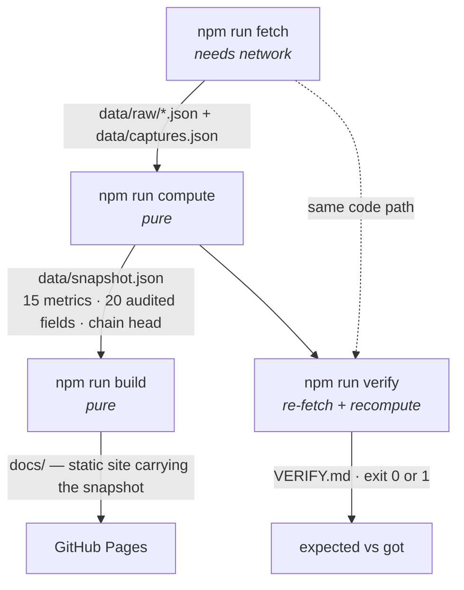
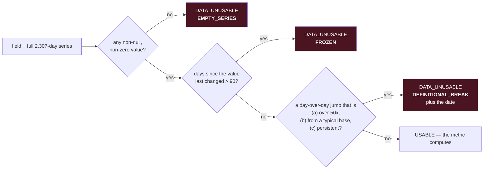
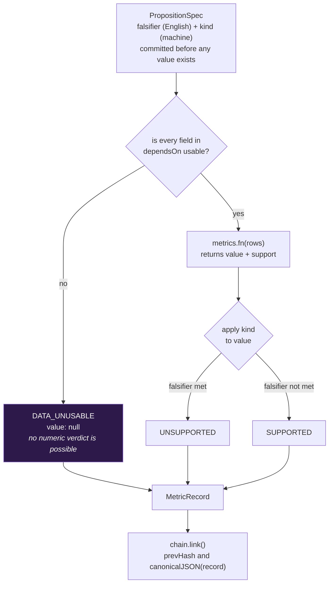
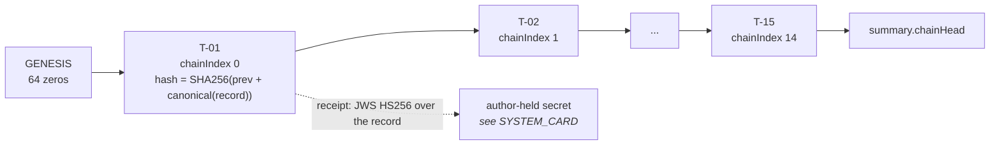
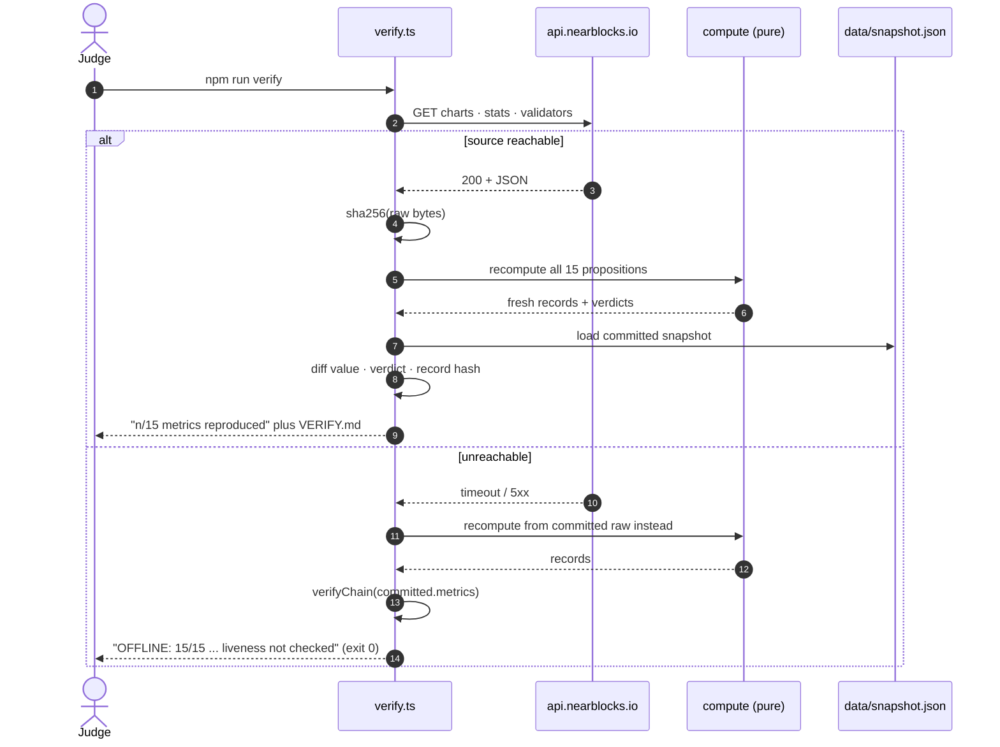
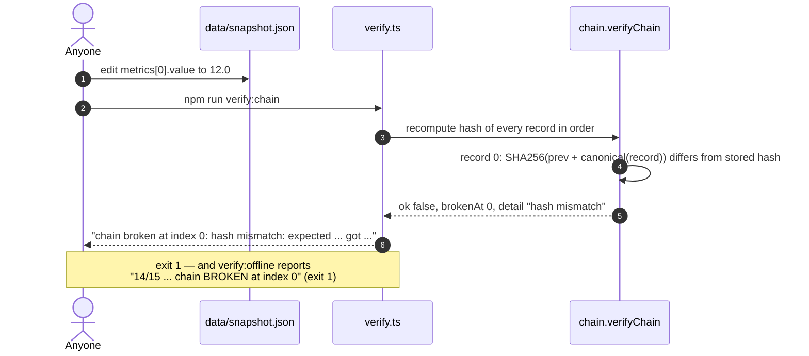

# nullius diagrams

Zones, flows and decision logic for this repository, drawn from the code in `src/`. GitHub renders every diagram below with no build step.

1. [Trust zones](#1--trust-zones) — which layer may touch the network, the clock, or a model
2. [The pipeline](#2--the-pipeline) — one capture from URL to verdict
3. [The audit gate](#3--the-audit-gate) — how a field becomes a finding instead of a number
4. [Verdict assignment](#4--verdict-assignment) — how a falsifier becomes a label
5. [The provenance chain](#5--the-provenance-chain) — what each hash commits to
6. [Sequence: verify](#6--sequence-verify) — the claim that any of this is true
7. [Sequence: tamper](#7--sequence-tamper) — why the chain is load-bearing

---

## 1 · Trust zones

The architecture exists to make one sentence true: *no number in this project was produced by anything other than deterministic code reading committed bytes.* That is enforced by confining network access, clock access and any model to **Zone 1**, and by a test (`test/architecture.test.ts`) that fails the build if `src/compute/**` imports an HTTP client, `node:fs`, `Date` or an LLM SDK.

```mermaid
flowchart LR
  subgraph Z0["Zone 0 · Public sources (untrusted, outside our control)"]
    NB["api.nearblocks.io<br/>/v1/charts · /v1/stats · /v1/validators<br/>read-only HTTPS GET"]
  end

  subgraph Z1["Zone 1 · Capture (the ONLY networked layer)"]
    FETCH["src/capture/fetch.ts<br/>GET · no transform<br/>records url + fetchedAt + sha256"]
    RAW[("data/raw/*.json<br/>byte-for-byte<br/>committed to git")]
  end

  subgraph Z2["Zone 2 · Deterministic compute (no I/O · no clock · no model)"]
    PARSE["parse.ts<br/>raw to typed rows<br/>throws on schema drift"]
    AUDIT["audit.ts<br/>20-field usability gate"]
    METRICS["metrics.ts · cluster.ts<br/>one pure fn per proposition"]
    VERDICT["verdict.ts<br/>the ONLY producer of a Verdict"]
    CHAIN["chain.ts · receipt.ts<br/>SHA-256 prev-hash link · JWS"]
    SNAP[("data/snapshot.json<br/>the data contract")]
  end

  subgraph Z3["Zone 3 · Presentation (a pure function of the snapshot)"]
    UI["src/web — React 19 + Vite<br/>Thesis · Audit · Ledger · Method<br/>no fetch at runtime"]
    PAGES["docs/ to GitHub Pages"]
  end

  subgraph Z4["Zone 4 · Verification"]
    VERIFY["src/cli/verify.ts<br/>re-fetch · recompute · diff"]
    REPORT["VERIFY.md<br/>expected vs got, per metric"]
  end

  NB -->|"HTTPS GET · JSON"| FETCH
  FETCH -->|"writes verbatim + sha256"| RAW
  RAW -->|"local read · refuses on hash mismatch"| PARSE
  PARSE --> AUDIT
  PARSE --> METRICS
  AUDIT -->|"unusable so short-circuit"| VERDICT
  METRICS --> VERDICT
  VERDICT --> CHAIN
  CHAIN --> SNAP
  SNAP -->|"imported at build time"| UI
  UI --> PAGES
  NB -.->|"re-fetch at verify time"| VERIFY
  SNAP --> VERIFY
  VERIFY --> REPORT

  classDef untrusted stroke-dasharray: 5 5
  classDef det fill:#0b3d2c,color:#ffffff
  class NB untrusted
  class PARSE,AUDIT,METRICS,VERDICT,CHAIN det
```

**Legend** — dashed = outside our control. Dark green = deterministic: no I/O, no clock, no model.

**Cross-cutting facts** — all timestamps UTC ISO-8601. `generatedAt` is the only non-deterministic field in the snapshot and is excluded from every hash. Secrets arrive by environment variable only. If a raw capture's recorded SHA-256 does not match its bytes, compute refuses to run rather than producing a figure.

---

## 2 · The pipeline

Three commands, three artifacts. The split matters: `fetch` is the only step that can fail for reasons outside the repo, and once it has run, every later step is reproducible forever from committed bytes.

`npm run snapshot` is `fetch && compute`. A judge never needs `fetch`: the captures are committed, so `verify:offline` reproduces all 15 figures with the network unplugged.

---

## 3 · The audit gate

This is the part the thesis is built on. The gate runs on **all 20 fields** the charts endpoint exposes, not on a list of suspected ones — which is why it surfaced `deleted_accounts`, a finding nobody asked it for, now carrying proposition T-12. A field is a *finding* rather than a number when it fails any of three tests.

Test (c) — persistence — is what separates a redefinition from an organic spike: the series must stay at the new level rather than returning. An exchange listing that triples volume for a day fails (c) and is correctly left usable; a field that jumps 1,052× on 2024-06-01 and never comes back passes all three. Implemented as `audit.worstPersistentBreak`, which is shared by the gate and by propositions T-07 and T-12, so a record and its audit entry can never disagree.

**The four findings, from `data/snapshot.json`:**

| Field | Reason | Evidence |
| --- | --- | --- |
| `multichain_txns` | EMPTY_SERIES | no non-null, non-zero value on any of 2,307 days |
| `circulating_supply` | FROZEN | last changed 2025-08-27 |
| `active_contracts` | DEFINITIONAL_BREAK | 2024-06-01: 738 → 776,038 |
| `deleted_accounts` | DEFINITIONAL_BREAK | 2024-08-15: 16 → 63,170 |

---

## 4 · Verdict assignment

A verdict is never typed and never tuned. `src/propositions.ts` holds the falsifier as committed English *and* as a machine `kind`; `compute/verdict.ts` is the only module in the repo permitted to return a `Verdict`.

Because the falsifier is committed text and the verdict is derived from it, the honest outcome is possible: **6 of the 15 propositions are published UNSUPPORTED**, including two about NEAR's validator decentralisation. A thesis that cannot fail is not evidence.

---

## 5 · The provenance chain

Each record's hash commits to everything about that record except its own `hash` and `receipt` — which cannot sign themselves — *including* its `chainIndex` and `prevHash`. So reordering, substituting or editing any record breaks the chain at that index and at every index after it.

Canonicalisation is explicit and lives in one function (`compute/canonical.ts`): keys sorted lexicographically, no whitespace, UTF-8, shortest round-trip number form. Hashing never goes through a bare `JSON.stringify`, because key-order drift across runtimes is the classic way a hash chain silently stops reproducing.

**Two different guarantees, deliberately separated:**

| Guarantee | Mechanism | Who can check it |
| --- | --- | --- |
| The published figures match the captured bytes | SHA-256 prev-hash chain | **anyone**, offline, no keys |
| The records were sealed by the author | JWS HS256 receipts | the author only (symmetric secret) |

The public claim rests entirely on the first. See [SYSTEM_CARD.md](../SYSTEM_CARD.md).

---

## 6 · Sequence: verify

The unhappy path is the interesting one. A judge with no network still gets a meaningful pass, and the output names exactly which guarantee was checked and which was not.

A figure that has legitimately moved since the capture is **a pass of the design, not a failure** — the thesis is built to turn against itself without anyone editing it. `VERIFY.md` names each drifted metric with both values so a reader decides for themselves.

---

## 7 · Sequence: tamper

What makes the chain load-bearing rather than decorative. Reproduce it in thirty seconds with `make tamper`, or by hand: edit any `value` in `data/snapshot.json` and run `npm run verify:chain`.

Both paths fail closed. `verify:offline` runs `verifyChain` on the committed records **before** it claims anything about the chain, so it can never report a matching head beside a failing metric.
